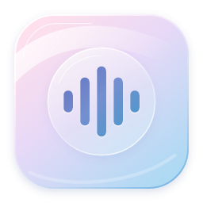
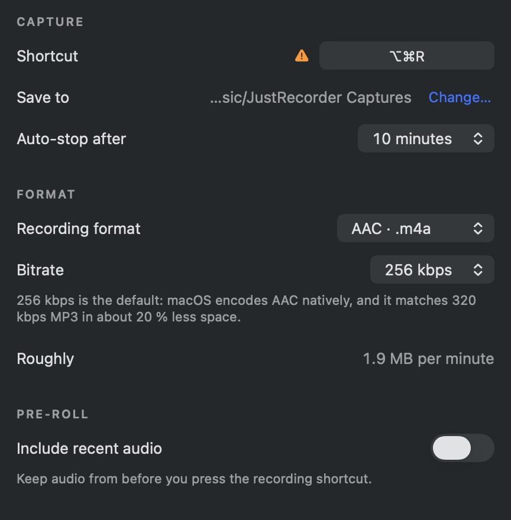
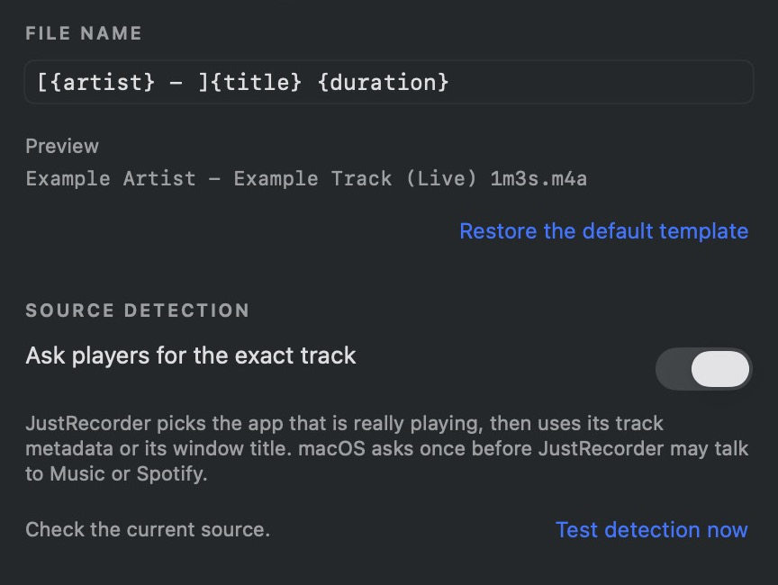
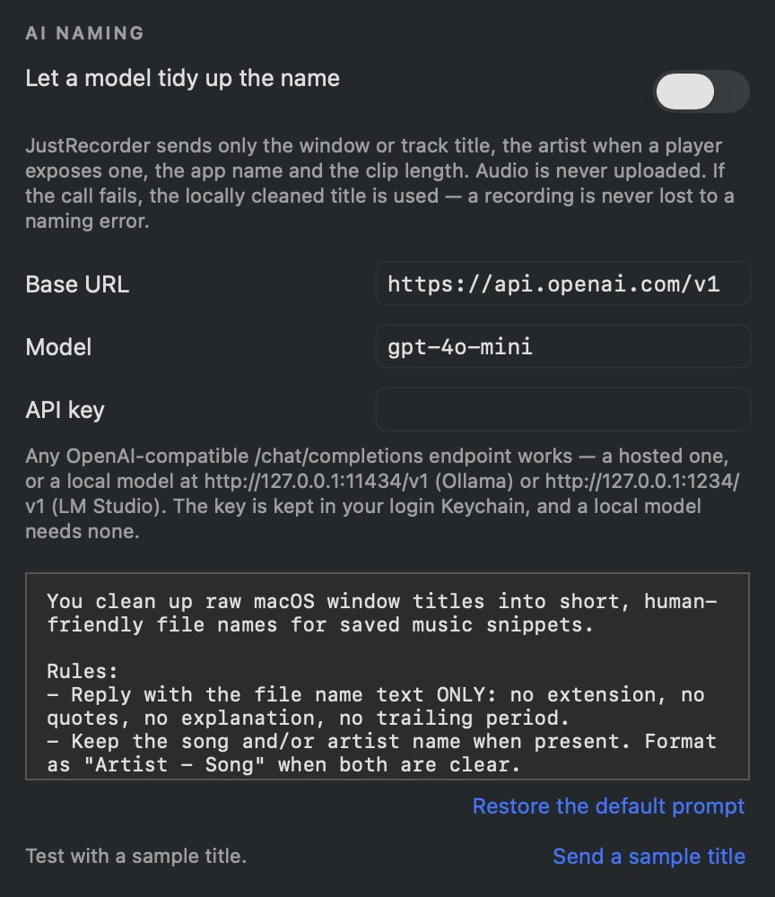
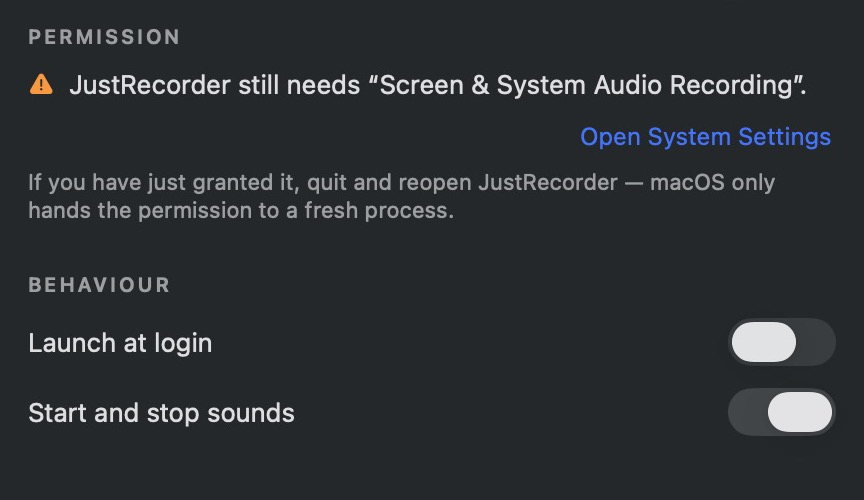

# JustRecorder



Version 1.0.0

**Record your computer’s audio.**

Press once to record. Press again to save a named audio clip.

No virtual audio driver. No microphone recording. No account.

Menus follow the system appearance, including automatic light/dark changes.

| | macOS | Windows |
|---|---|---|
| Runs on | macOS **13+**, Intel & Apple silicon | Windows **10 build 19041+** / 11, x64 / x86 / ARM64 |
| Start / stop | **⌥⌘R** | **Ctrl+Alt+R** |
| Find JustRecorder | Waveform in the menu bar | Notification area beside the clock; check the **^** arrow |
| Default save folder | `~/Music/JustRecorder Captures` | Your Music folder → `JustRecorder Captures` |
| Current verification | Builds and synthetic-audio tests pass | Cross-builds and portable tests pass; **live Windows recording/UI not yet verified** |

Big Sur and Monterey are unsupported. JustRecorder does not install BlackHole or reroute your audio.

## Your first recording

Have source code rather than an app? Start with [Build from source](#build-from-source).
On Mac, open the built `JustRecorder.app`; on Windows, use the ZIP for your processor
(x64 for most PCs, ARM64 for Windows on ARM, x86 for 32-bit Windows).

1. **Open JustRecorder.** On Windows, extract the entire ZIP first, then run `JustRecorder.exe`; keep its neighboring files together.
2. **Mac only:** start a recording to check access. If macOS asks, allow Screen & System Audio Recording, then quit and reopen JustRecorder. The exact permission label varies by macOS version.
3. **Play something.** Press your platform’s shortcut to start; press it again to stop and save.
4. **Find the clip.** Open JustRecorder’s menu → **Reveal last recording**. Use **Open save folder** for all clips.

Example filename: `Example Artist - Example Track (Live) 1m3s.m4a`

Default: **AAC · 256 kbps · 48 kHz stereo**. Auto-stop: **10 minutes**. AI naming and pre-roll: **off**.

## Features at a glance

| Want to… | Go to Settings → |
|---|---|
| Change shortcut, save folder, quality or auto-stop | **Capture** |
| Include the previous 5–30 seconds | **Capture → Pre-roll** |
| Preview filenames or test title detection | **Naming** |
| Use your own AI endpoint to clean titles | **AI naming** |
| Launch at login or change feedback | **General** |

Mac edits save automatically. Windows: choose **Save** or **Done**; closing also attempts to save. **Discard unsaved edits** lets you leave without applying changes.

## Feature screenshots

Cropped from the actual macOS settings UI with fictional English placeholders and no API key.
Each image shows one feature panel. Windows UI testing is pending.

### Capture and format

Choose your shortcut, save folder, format, and pre-roll in **Settings → Capture**.



### Filename preview and detection

Edit the template and see the filename before recording in **Settings → Naming**.



### Optional AI naming

Configure your endpoint and test a sample title in **Settings → AI naming**.



### Permissions and startup

Check recording access and launch-at-login behavior in **Settings → General**.
The permission and shortcut warnings reflect the isolated documentation instance.



## Choose a format

| Format | Best for | Extra requirement |
|---|---|---|
| **AAC / M4A** | Everyday clips; default | Windows N may need Media Feature Pack |
| **MP3** | Broad compatibility | Mac: `lame` or `ffmpeg`; Windows: system encoder |
| **Apple Lossless / M4A** | Lossless audio | Windows: your own `ffmpeg.exe` |
| **WAV 16 / 24-bit** | Audio editing | None |

If a conversion fails, the original WAV is retained. On Mac, choosing MP3 without an encoder falls back to AAC. Windows captures to a temporary float WAV before conversion, so it needs more temporary disk space than the final compressed clip.

## Naming and privacy

JustRecorder uses player metadata or window titles when available. You can customize the filename:

```text
[{artist} - ]{title} {duration}
```

The artist group disappears when no artist is known. Existing filenames get a number instead of being overwritten. [All tokens and advanced options →](docs/REFERENCE.md#naming)

**Audio stays on your computer.** Optional AI naming sends text metadata and duration to the endpoint you configure. Keys are stored in macOS Keychain or Windows Credential Manager. No analytics or update checks. AI failures use the local title.

## If something goes wrong

| Symptom | Next step |
|---|---|
| Can’t find JustRecorder | Mac: menu bar. Windows: hidden-icons **^** menu; double-click JustRecorder for Settings. |
| Capture reports a timeout | Quit and reopen JustRecorder before retrying. The app will not queue more requests against an unresponsive capture service. |
| Shortcut does nothing | Try **Start recording** from JustRecorder’s menu. Choose another shortcut in Capture if the combination is taken. |
| Permission keeps appearing on Mac | Quit every copy, keep one installed app, and reopen it. If a rebuilt app is still denied, remove the old entry in Screen & System Audio Recording and add the installed app again. |
| Silent clip on Mac | Check recording permission, reopen JustRecorder, and confirm audio is playing through this Mac. |
| Silent clip on Windows | Check the default playback device. Protected or exclusive-mode playback may not be capturable. |
| Names show only an app name | Try **Naming → Test detection**. Some players expose no track metadata; AI cannot recover missing information. |
| Conversion failed | Look for the preserved WAV in the save folder; check the required encoder. |
| App quit during saving | Reopen it. Readable interrupted WAV/audio files are recovered into the save folder; unreadable files are retained. |

Pre-roll keeps capture active while idle. On Windows the timer is in the tray tooltip; start sounds are omitted and stop sounds are suppressed with pre-roll. [Windows details →](Windows/README.md)

## Build from source

**Mac** — Xcode Command Line Tools, Swift 5.9+:

```bash
./build.sh --universal   # build/JustRecorder.app — Intel + Apple silicon
./build.sh --install     # build for this Mac, install and launch
./test.sh                # regression checks
python3 Tests/test_source_release.py
python3 source-release.py # clean source ZIP
```

**Windows** — .NET 10 SDK, PowerShell:

```powershell
./Windows/build.ps1                     # x64 ZIP
./Windows/build.ps1 -Runtime win-arm64  # Windows on ARM
./Windows/build.ps1 -Runtime win-x86    # 32-bit Windows
```

The Windows ZIP includes the runtime. The Mac app is ad-hoc signed, not notarized; Windows packages are not Authenticode-signed. Your operating system or organization may block these builds.

[Mac build details and troubleshooting](docs/REFERENCE.md) · [Windows build and verification](Windows/README.md)

Original project code: all rights reserved. Third-party notices are retained in the source and packages.

## Automatic builds

GitHub Actions runs on every push, pull request, or manual dispatch. Successful runs
provide the universal Mac app and source ZIP, plus Windows x64, x86, and ARM64 ZIPs
under **Actions → workflow run → Artifacts**. Missing outputs or failing tests fail
the run. Windows x64/x86 builds test native codecs; ARM64 is cross-built.
These workflows build downloads; they do not create a GitHub Release or sign a
public distribution. The workflows have been checked locally but not run in a
hosted repository yet.

## Automatic downloads

Every successful build from a push to `main` refreshes the public **1.0.0** release.
All required platform builds and checks must pass first. Downloads use
`App-1.0.0-OS-architecture.ext`, such as `App-1.0.0-macOS-universal.zip`
or `App-1.0.0-Windows-x64.exe`. See [release automation](.github/RELEASES.md)
for the exact packages, checksums, and retry behavior.
