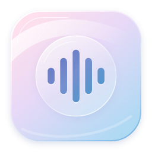

# JustRecorder for Windows

Windows tray recorder targeting Windows 10 version 2004 (build 19041) and later,
including Windows 11. This is a separate native Windows implementation; the Swift
app remains a driver-free macOS 13+ app for Intel and Apple silicon. Big Sur and
Monterey are not supported, and no virtual audio driver is installed.

## Build and run

With the .NET 10 SDK, run `./build.ps1` in PowerShell. Choose `-Runtime win-x86`
for 32-bit Windows or `-Runtime win-arm64` for Windows on ARM. The default is x64.
Packaging uses a fresh staging folder and replaces the ZIP only after the build and checks pass. The output ZIP includes the runtime: extract the entire folder and run `JustRecorder.exe`.
Keep the files together. No administrator privileges are needed. This build is
not Authenticode-signed; organizational policies may prevent launching it.

A GitHub Actions workflow runs the portable regression tests and packages all three
architectures on Windows when hosted in a repository. The x64 and x86 jobs also run `JustRecorder.exe --self-test` to check the synthetic audio writer
and readable AAC, MP3, WAV16 and WAV24 output using Windows codecs. It does not simulate a live
audio device; a successful CI build does not establish recording compatibility.

## Recording

On first launch, JustRecorder explains where its icon lives and opens Settings.

**Ctrl+Alt+R** starts/stops recording; change the shortcut in Settings. JustRecorder lives in
the notification area (possibly under the hidden-icons arrow). Double-click the icon
for Settings. The menu offers start/stop, reveal last recording, open save folder,
Settings, and quit. The duration is shown in the tray tooltip while recording.

Capture uses WASAPI loopback on the default Windows playback device and never
records a microphone. If the output changes, the clip is stopped and saved; the
next capture uses the new output. Protected audio and exclusive-mode streams may
not be available to shared-mode loopback capture.

Pre-roll retains 5–30 seconds in memory. Auto-stop is configurable up to 30 minutes,
or can be disabled. Clips under 0.3 seconds are discarded. Stop sounds are disabled
with pre-roll, and start sounds are omitted because Windows endpoint loopback would
record JustRecorder's own sounds. Windows system audio is not rerouted.

## Formats and naming

- AAC in M4A, 128–320 kbps: Windows Media Foundation.
- MP3, 128–320 kbps: Windows Media Foundation.
- Apple Lossless in M4A: requires your own `ffmpeg.exe` beside JustRecorder or on PATH.
  FFmpeg is not downloaded or redistributed by this project.
- WAV, 16-bit or 24-bit: native PCM output.

Recording first writes an intermediate float WAV, then encodes after closing it.
If encoding fails, the original float WAV is kept and JustRecorder displays a notification.
Windows N editions may need the Media Feature Pack for AAC/MP3. The filename uses
the format actually saved. A separate log is kept under `%LOCALAPPDATA%\JustRecorder`.

Windows media sessions supply artist and track metadata when available. Otherwise,
JustRecorder ranks windows using active playback sessions and the foreground window. Not all
players expose metadata; detection falls back to the application name or Snippet.
Settings provides a live template preview and a detection test. All macOS naming
tokens are supported; optional `[groups]` disappear if a token is empty. Filenames
are sanitized for Windows, including reserved device names, and existing files
are never overwritten.

AI naming is optional. Only textual metadata and clip duration are sent to the
configured OpenAI-compatible endpoint. Remote endpoints require HTTPS; local models
may use HTTP. The API key is stored in Windows Credential Manager, never in settings
JSON. AI errors fall back to local naming. A sample-title test and editable prompt
are available. Closing Settings cancels its pending test.

Settings include launch at login, reveal after save, stop sound, tooltip timer,
output folder, formats, sample rate, pre-roll, metadata detection and AI naming.
Use Save or Done to persist edits; closing Settings also attempts to save and stays
open if validation or credential storage fails. “Discard unsaved edits” closes the
window without retrying a failed save.

Interrupted recordings remain as `.justrecorder-*.wav` files in the save folder. WAV
headers are flushed while capturing. On next launch, completed readable audio is
recovered under `Recovered Snippet …`; files belonging to live processes are left
alone, and temp files from older builds are recovered the same way.
Unreadable files are retained for manual recovery. Quitting waits up to three seconds
for saving and leaves unfinished intermediates for the next launch.

## Verification boundary

Run `dotnet run --project JustRecorder.Tests -c Release` for portable logic tests. Actual
WASAPI capture, Media Foundation encoding, Credential Manager, media sessions,
global shortcuts, device switching, pre-roll, sleep/resume and tray accessibility
require a Windows machine. Test Windows 10 22H2 and Windows 11 with speakers,
Bluetooth output and an output-device change before treating a package as production
ready. A Mac cross-build cannot verify those operating-system behaviors.

NAudio 2.2.1 is MIT-licensed; its notice is included in the package. .NET runtime
notices ship with the self-contained output. FFmpeg remains separately installed.
